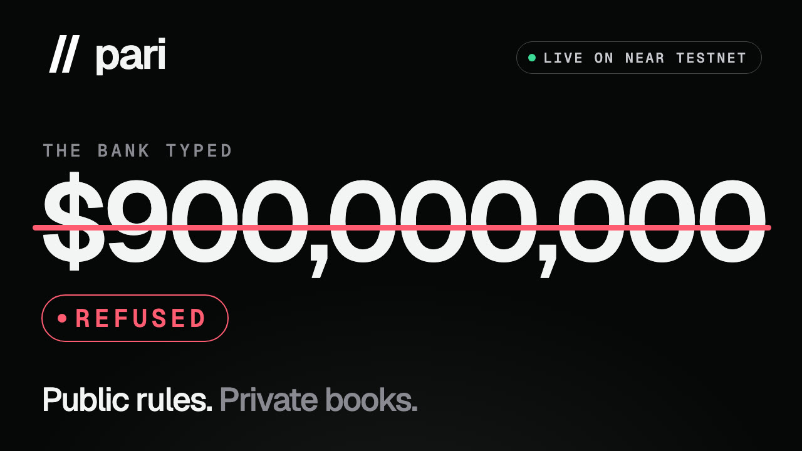
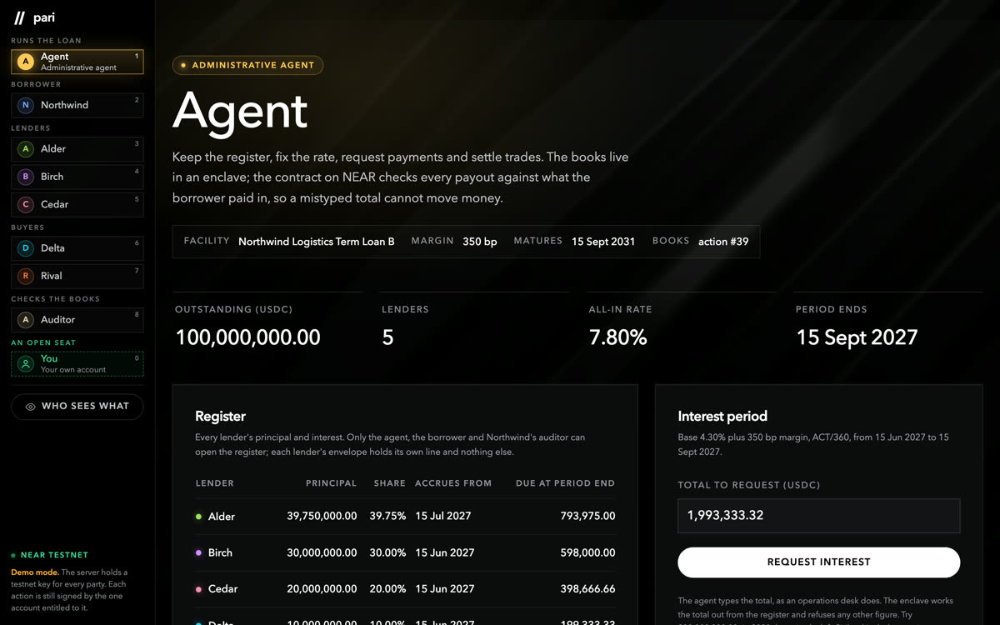
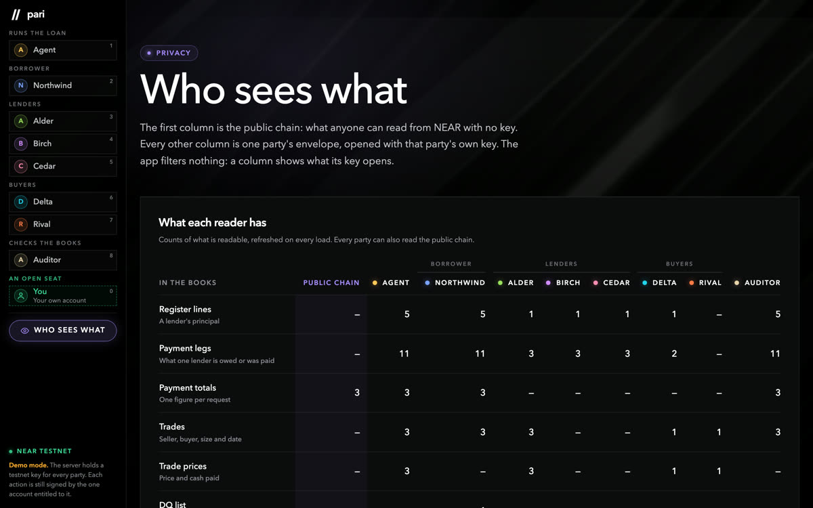
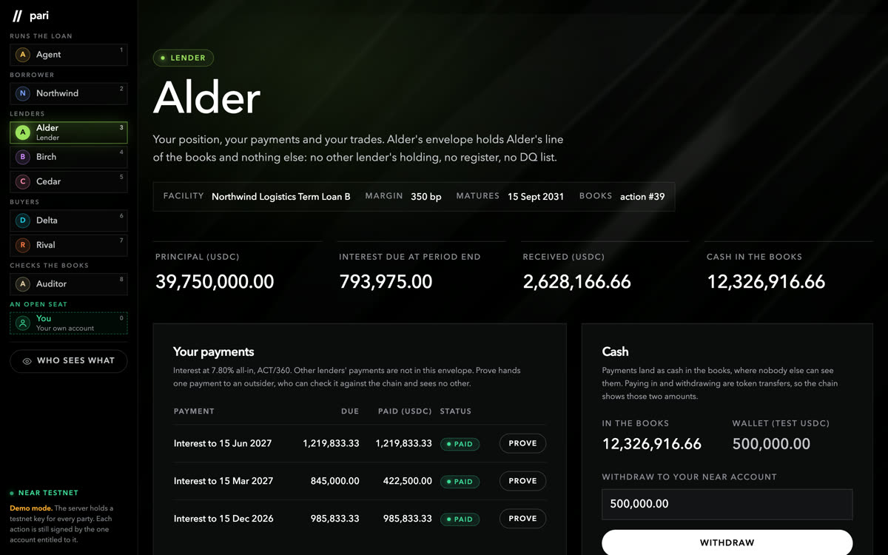
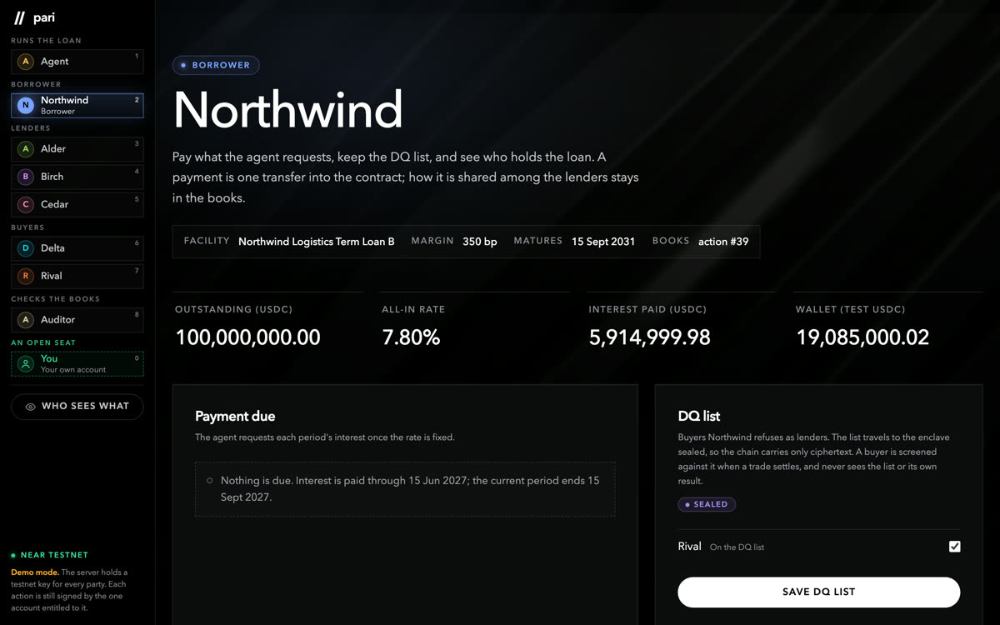
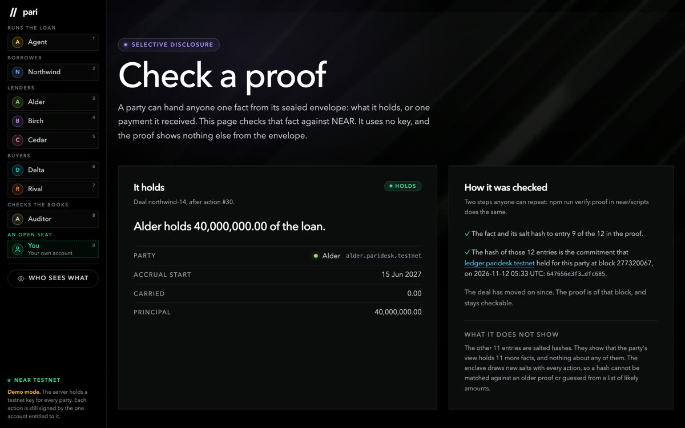
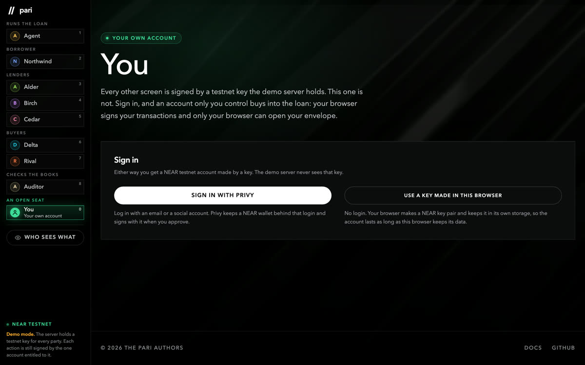
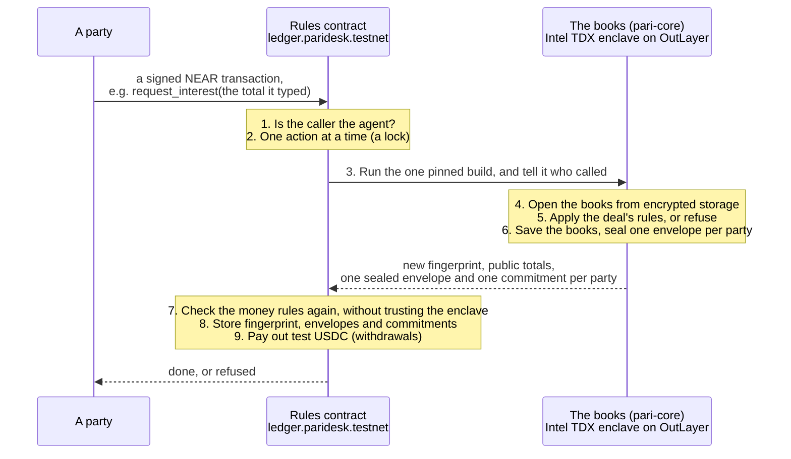

<div align="center">

<br/>

<picture>
  <source media="(prefers-color-scheme: dark)" srcset="docs/assets/logo-dark.svg" />
  
</picture>

<h1>pari</h1>

**Public rules. Private books.**<br/>
A syndicated loan's books on NEAR, where each party sees only its own.

[](https://testnet.nearblocks.io/address/ledger.paridesk.testnet)
[](#how-it-works)
[](#tests)
[](#near-hackathon)
[](LICENSE)

[**Demo video**](https://drive.google.com/file/d/1pXDP2xvQYVXytzLS76H9bqHQYKBfDEaq/view?usp=sharing) · [**Live demo**](https://pari-web-production-5ff7e57a.up.railway.app) · [**60-second tour**](#60-second-tour-for-judges) · [**Check it yourself**](#check-it-yourself) · [**Contract on testnet**](https://testnet.nearblocks.io/address/ledger.paridesk.testnet) · [**Full guide**](docs/guide.md)

<a href="https://drive.google.com/file/d/1pXDP2xvQYVXytzLS76H9bqHQYKBfDEaq/view?usp=sharing"></a>

</div>

Pari keeps the administrative agent's books for a syndicated loan. The rules run in a NEAR contract, in public. The books run inside an Intel TDX enclave. The public chain sees one total and a fingerprint, each lender opens only its own sealed envelope, and a mistyped $900M payment is refused.

Built at **NEAR HACKATHON**. Tracks: privacy (primary) and realworld.

- Demo video: [watch it](https://drive.google.com/file/d/1pXDP2xvQYVXytzLS76H9bqHQYKBfDEaq/view?usp=sharing) (2 min 27 s)
- Live demo: https://pari-web-production-5ff7e57a.up.railway.app
- Everything in detail: [docs/guide.md](docs/guide.md)

> Every transaction linked in this README is a real one on NEAR testnet.

---

## The problem

In 2020 Citibank, as the administrative agent on Revlon's loan, meant to pay about $7.8M of interest and wired about $900M of its own money instead. Loan agency still runs on email, PDFs and spreadsheets.

A public blockchain can't hold a loan's books either. It would publish every lender's position, every trade price and the borrower's list of banned buyers (the DQ list).

## 60-second tour for judges

On the [live demo](https://pari-web-production-5ff7e57a.up.railway.app). It plays one live deal on NEAR testnet, so it is wherever the last visitor left it.

1. Open **`/visibility`**. The first column is what anyone can read from NEAR: one total per interest request, the books' fingerprint and sealed envelopes. Under **Checked live**, eight claims read **Holds**.
2. Open **`/lender/alder`**, then **`/lender/birch`**. Each shows its own position and payments, and nothing of the other's.
3. On `/lender/alder`, press **Prove** beside a payment. You land on `/verify` and see **It holds**: one fact from a sealed view, checked against NEAR with no key.
4. Open **`/agent`**. If **Request interest** is showing, replace the total with `900,000,000.00` and press it. You see **Refused**, with the figure the register says, and nothing changes. The same refusal on a recorded run: [`o36Pf9jk…`](https://testnet.nearblocks.io/txns/o36Pf9jk2zAAGQ8sf8xLa4Edo7DHGAA2qgGT3Bb5P58).
5. Open **`/you`** and take a seat with an account only you control.

The exact walk, with the figure to expect at every step, is in the [full guide](docs/guide.md#2-play-the-deal-in-the-browser).

## See it

Every frame is the live app on NEAR testnet. No mock-ups.

<table>
  <tr>
    <td width="50%"><br/><sub><b>The agent's desk.</b> The register, and the total the agent must type to request interest.</sub></td>
    <td width="50%"><br/><sub><b>Who sees what.</b> The public chain's column beside each party's own.</sub></td>
  </tr>
  <tr>
    <td><br/><sub><b>A lender's view.</b> Alder sees its own position, payments and cash, and no other lender's.</sub></td>
    <td><br/><sub><b>The borrower.</b> Its list of banned buyers goes to the enclave sealed.</sub></td>
  </tr>
  <tr>
    <td><br/><sub><b>Prove one fact.</b> "Alder holds 40,000,000.00 of the loan", checked against NEAR with no key.</sub></td>
    <td><br/><sub><b>Your own seat.</b> Your browser signs your transactions and only it can open your envelope.</sub></td>
  </tr>
</table>

## How it works



Steps 3 to 6 are one NEAR transaction: the contract calls OutLayer, waits (yield/resume), and gets the answer in a callback.

- **Two guards stand between a typo and the money.** The enclave works the total out from the register and refuses any other: "You entered 900,000,000.00; the register says 1,971,666.66." The contract checks on its own that lenders are never credited more than the borrower paid in, and never pays out more than it holds.
- **Secrets never touch the chain in the clear.** A trade's buyer, size and price, the DQ list and the opening positions are sealed to the enclave's key before they go into a transaction. Lender payments are credits inside the books, not token transfers.
- **A copied secret is no use.** Sealed fields name the deal, the caller and the command, so Birch can't send Alder's sealed offer as its own.
- **A fingerprint confirms no guess.** The books carry 32 random bytes, drawn again with every answer, so nobody can hash "Alder 50 million" and compare.
- **Prove one fact, and nothing else.** Each party's envelope comes with a salted commitment on chain. A party can hand anyone one fact from its view, and they check it against NEAR with no key.

Each of these has a test and a longer explanation in the [full guide](docs/guide.md#how-it-works).

## What each party sees

| Reader | Sees | Never sees |
|---|---|---|
| **Agent** | The whole register, every payment leg, every trade with its price | The DQ list itself |
| **Borrower** | The register, every payment, every trade, its own DQ list | Trade prices |
| **Each lender** | Its own position, payments, cash and trades | Any other lender's position or payment, the DQ list |
| **A buyer** | Its own trades, and its position once it has bought in | The DQ list. A refused buyer is told "not settled" and no reason |
| **Auditor** | The register through every payment and trade | Trade prices, the DQ list |
| **The public chain** | Who takes part, one total per interest request, deposits and withdrawals, fingerprints, envelope ciphertext | Positions, per-lender payments, trade sizes and prices, the DQ list |

## Why this needs NEAR

- **A contract can call an enclave and get the answer back in the same transaction.** OutLayer runs the books inside Intel TDX with encrypted storage, and the NEAR contract resumes with the result. The contract, not a server, decides when the books run.
- **Keys that nobody holds.** OutLayer's keystore derives the storage key for this program *and* the contract that called it. The developer has no copy.
- **Named accounts for every role.** `agent.paridesk.testnet`, `alder.paridesk.testnet`: role checks and views are keyed by names a person can read.
- **One token transfer that also runs the books.** The borrower pays with `ft_transfer_call`; if the books refuse, the tokens go back.
- **An agent that is two of three.** Name a [Sputnik DAO](https://github.com/near-daos/sputnik-dao-contract) as the deal's agent and every agent action needs two of three operators. Two operators can approve a request for 900,000,000.00 and the enclave still refuses it.

## Proof on testnet

| | |
|---|---|
| Rules contract | [`ledger.paridesk.testnet`](https://testnet.nearblocks.io/address/ledger.paridesk.testnet) |
| Enclave program | OutLayer project `paridesk.testnet/pari-core`, one build pinned by its sha256 |
| Agent as a DAO | [`paridesk-agent.sputnikv2.testnet`](https://testnet.nearblocks.io/address/paridesk-agent.sputnikv2.testnet) |
| Test USDC | [`usdc.paridesk.testnet`](https://testnet.nearblocks.io/address/usdc.paridesk.testnet) (no value) |

Two full runs of the deal are recorded: `northwind-14` (36 transactions) and `northwind-13`, played with the DAO as the agent (62 transactions).

| Step | Transaction |
|---|---|
| The agent types 900,000,000.00: refused | [`o36Pf9jk…`](https://testnet.nearblocks.io/txns/o36Pf9jk2zAAGQ8sf8xLa4Edo7DHGAA2qgGT3Bb5P58) |
| The agent requests 1,971,666.66 | [`3AVZW7vF…`](https://testnet.nearblocks.io/txns/3AVZW7vFPf791Ro9vmaD1xdzv19wHQ2eEmjsJaXDg1ge) |
| The borrower pays, in one transfer | [`MZM57dBE…`](https://testnet.nearblocks.io/txns/MZM57dBEUMQ8NwzSzQ9HGCyahkDNXSzuAF6yyPARgU6) |
| One settlement pays three lenders | [`Dndv3Zvq…`](https://testnet.nearblocks.io/txns/Dndv3ZvqtTQh8JktXri4mieVPf8fyq59woE9aguFzQ4U) |
| Rival, on the DQ list: its trade is not settled | [`D85FiUHa…`](https://testnet.nearblocks.io/txns/D85FiUHaum7vGh1BCVzZ9TUqrPhC7mAw4U6SaF8ApCEi) |
| Delta's trade settles, cash against loan | [`CM8FBYGP…`](https://testnet.nearblocks.io/txns/CM8FBYGPz3yjzo7A29zY3LpR9gbVJtVjC5gKz8rdnYKo) |
| DAO: operator 1 approves, nothing moves | [`GcGWLS8L…`](https://testnet.nearblocks.io/txns/GcGWLS8LUHRo3d4LXkVe2nnyzY87Vi3qm1pUSuhgM89L) |
| DAO: operator 2 approves, three lenders are paid | [`3zDwMAgB…`](https://testnet.nearblocks.io/txns/3zDwMAgBqobDbDhi1hBdLVVEvtvXcaHjHbz2UvBNqjcF) |

**The leak test.** `npm run prove:privacy` downloads every transaction of a recorded run and the contract's whole storage from NEAR, and searches them for 29 secrets: each lender's position, each payment, the trade's size and price, the DQ list. It needs no keys, and ends:

```
PASS: 0 secrets in 2,216,417 bytes of public data.
```

Every transaction and both full outputs are in the [full guide](docs/guide.md#the-leak-test).

## Check it yourself

With no account and no keys, in about five minutes. You need [Rust](https://rustup.rs) and Node.js 22.

```bash
git clone https://github.com/martinvibes/pari && cd pari

(cd near/enclave && cargo test)     # the deal's rules, with the deal's numbers
(cd near/contract && cargo test)    # roles, the lock, the money caps

cd near/scripts && npm install
npm run prove:privacy               # reads NEAR testnet; needs no key
npm run verify:proof                # checks one fact from a sealed view; needs no key
```

You should see:

- `cargo test` in `near/enclave`: 28 tests pass (five files: 3, 5, 4, 11 and 5).
- `cargo test` in `near/contract`: `26 passed`.
- `npm run prove:privacy` ends with `PASS: 0 secrets in … bytes of public data.`
- `npm run verify:proof` ends with `PASS: the fact is what the enclave put in this party's view, and the proof shows no other.`

The scripts read NEAR through a free public RPC. When it answers `Rate limits exceeded` they wait and try again, so a step can pause for up to four minutes.

To go further, the full guide has [the deal in the browser, step by step](docs/guide.md#2-play-the-deal-in-the-browser), [your own deployment on testnet](docs/guide.md#3-your-own-deployment-on-testnet) in about ten minutes, and [the agent as two of three](docs/guide.md#the-agent-as-two-of-three).

## Trust model

- **You trust Intel TDX and OutLayer's attested workers and keystore.** Each run of the enclave has a TDX attestation you can fetch by transaction hash.
- **You trust the one enclave build the contract pins**, named by its sha256 in the transaction that starts the deal. The build is not yet bit-for-bit reproducible across machines.
- **The contract account still has its full-access key** in this demo. Its holder could replace the contract. In production that key is deleted or handed to a DAO.
- **The demo server holds a testnet key for every party**, so one browser can play the whole deal. Each action is still signed by the one account entitled to it. The exception is `/you`, where your browser holds the keys.
- **The chain shows some things on purpose:** who is in the syndicate, deposits and withdrawals with amounts, who did what and when, one total per request, and envelope sizes.
- **Not built:** prepayments, inside-information documents and a hundred-lender scale test.

The [full trust model](docs/guide.md#trust-model) lists everything the chain shows, including what a careful reader could infer.

## Tests

```
enclave   interest     5   one-step payment to the cent, pro rata, no favourites, all or none
          trading      5   cash against loan, interest split on the trade date, DQ screening, trade privacy
          principal    4   the Revlon guard: no request, settlement or withdrawal above what is due
          authority    3   only the right party runs each command
          protocol    11   one envelope per party, one-fact proofs, late answers, no guess confirmed, no box reused
contract              26   roles, one action at a time, credited ≤ paid in, payouts ≤ held, freeze
───────────────────────────────────────────────────────────────────────────────────────────────────
54 tests passing
```

Money is whole cents in integers everywhere. `npm run e2e` plays the whole deal on testnet and checks every figure and every envelope. The code is in [`near/contract`](near/contract/src) (the rules), [`near/enclave`](near/enclave/src) (the books), [`near/scripts`](near/scripts/src) (setup, the end-to-end run, the leak test) and [`web`](web) (the app).

## NEAR HACKATHON

- **Tracks:** privacy (primary), realworld.
- **Built during the hackathon:** everything under [`near/`](near), plus [`web/lib/near`](web/lib/near), [`web/components/near`](web/components/near) and the [`/you`](web/app/(app)/you) page: the contract, the enclave program, the test token, the scripts and the app's NEAR data layer and screens. The full diff from the earlier build is [`pre-hackathon...main`](https://github.com/martinvibes/pari/compare/pre-hackathon...main).
- **Existed before:** Pari was first designed for Canton at HackCanton Season 3. That build is tagged [`pre-hackathon`](https://github.com/martinvibes/pari/tree/pre-hackathon) (commit `392e45c`, the build as of 7 October 2026), and it stays there whole. The NEAR version reuses its idea, its demo deal, its test names and numbers, and the web app's visual layer. The Canton code was removed from `main` on 13 November 2026, so `main` holds the NEAR build alone.
- **Libraries:** near-sdk and near-contract-standards 5.30, cargo-near 0.23, the OutLayer SDK 0.2, crypto_box 0.9 (libsodium-compatible sealed boxes), sha2, hmac, serde, base64 and getrandom in Rust; near-api-js 7.5, libsodium-wrappers 0.8, @privy-io/react-auth 3.51, Next.js 14 and React 18 in TypeScript.
- **AI tools:** the code was written with Claude Code (Anthropic) as a coding agent, directed and reviewed by the builder.
- **The builder's other entry:** [Selkie](https://github.com/SelkieLabs/Selkie).
- **Credit:** the web app's visual layer is derived from [sidereal-hedera](https://github.com/guha-rahul/sidereal-hedera) (Apache-2.0). See [NOTICE](NOTICE).

## What's next

- Withdrawals through NEAR's confidential intents, so that even those amounts are hidden.
- The agent admits an account before it can call the contract.
- A bit-for-bit reproducible enclave build.

## License

Apache-2.0. See [LICENSE](LICENSE).
