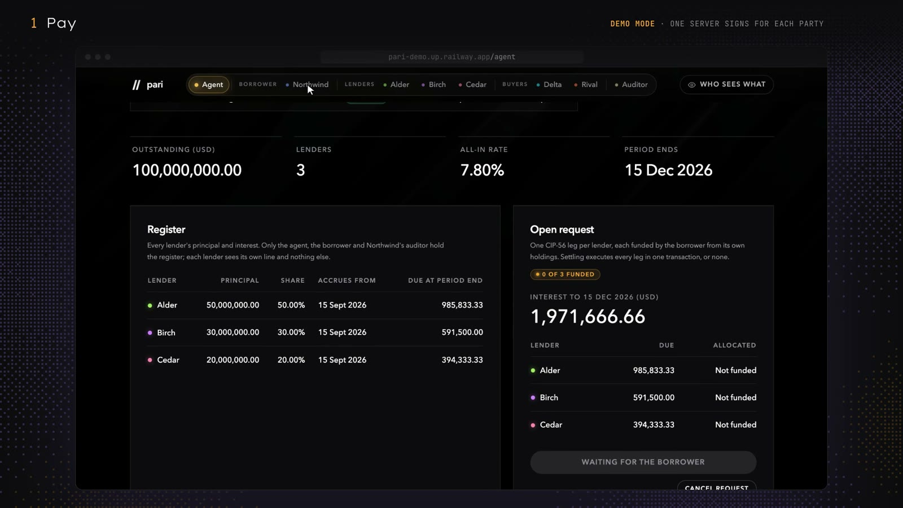

<div align="center">

<br/>

<picture>
  <source media="(prefers-color-scheme: dark)" srcset="docs/assets/logo-dark.svg" />
  
</picture>

<h1>pari</h1>

**A syndicated loan's books on NEAR. Each party sees only its own.**

The rules run in a NEAR contract. The books run inside an Intel TDX enclave.<br/>
The public chain sees one total and a fingerprint, and a mistyped $900M payment is refused.

[](#tests)
[](https://testnet.nearblocks.io/address/ledger.paridesk.testnet)
[](#how-it-works)
[](#near-hackathon)
[](LICENSE)

[Check it in five minutes](#check-it-yourself) · [The leak test](#the-leak-test) · [Contract on testnet](https://testnet.nearblocks.io/address/ledger.paridesk.testnet) · [Trust model](#trust-model) · [The earlier Canton build](#pari-on-canton)

</div>

---

> This README has two parts. **Pari on NEAR** is the NEAR HACKATHON entry and comes first. **[Pari on Canton](#pari-on-canton)**, below the divider, is the earlier build it grew from; it is kept unchanged and disclosed in [NEAR HACKATHON](#near-hackathon).

## The problem

In 2020 Citibank, as the administrative agent on Revlon's loan, meant to pay about $7.8M of interest and wired about $900M of its own money instead. Loan agency still runs on email, PDFs and spreadsheets.

A public blockchain can't hold a loan's books either. It would publish every lender's position, every trade price and the borrower's list of banned buyers (the DQ list).

## What Pari does

Pari keeps the administrative agent's books for a syndicated loan:

- every lender is paid in one step, to the cent;
- a trade settles cash against loan in one step, or not at all;
- each party sees only what it is entitled to;
- the agent can't overpay anyone.

On NEAR, those books are two programs that check each other.

| | Where it runs | What it does |
|---|---|---|
| **The rules contract** | [`ledger.paridesk.testnet`](https://testnet.nearblocks.io/address/ledger.paridesk.testnet), source in [`near/contract`](near/contract/src) | Checks who may do what, runs one action at a time, holds the test USDC and caps every payout. |
| **The books** (`pari-core`) | An Intel TDX enclave on [OutLayer](https://outlayer.ai), source in [`near/enclave`](near/enclave/src) | Keeps positions, cash, trade prices and the DQ list in encrypted storage, and applies the deal's rules. |

After every action the enclave hands back a **fingerprint** of the new books (a sha256) and one **sealed envelope per party**, encrypted so only that party can open it. The contract stores both. The public chain sees rules, totals and fingerprints. Each party opens its own envelope and sees its own slice.

## How it works

```
 a party                  the rules contract                   the books (pari-core)
 signs a NEAR tx          ledger.paridesk.testnet              Intel TDX enclave on OutLayer
      │                          │                                      │
      │  request_interest        │                                      │
      │  (the total it typed)    │                                      │
      ├─────────────────────────▶│ 1. is the caller the agent?          │
      │                          │ 2. one action at a time (a lock)     │
      │                          │ 3. run the one pinned build, and     │
      │                          │    tell it who called                │
      │                          ├─────────────────────────────────────▶│ 4. open the books from
      │                          │                                      │    encrypted storage
      │                          │                                      │ 5. apply the deal's rules,
      │                          │                                      │    or refuse
      │                          │  new fingerprint, public totals,     │ 6. save the books; seal one
      │                          │  one sealed envelope per party       │    envelope per party
      │                          │◀─────────────────────────────────────┤
      │                          │ 7. check the money rules again,      │
      │                          │    without trusting the enclave      │
      │                          │ 8. store fingerprint and envelopes   │
      │   done, or refused       │ 9. pay out test USDC (withdrawals)   │
      │◀─────────────────────────┤                                      │
```

Steps 3 to 6 are one NEAR transaction: the contract calls OutLayer, waits (NEAR's yield/resume), and gets the answer in a callback.

**Two guards stand between a typo and the money.**

1. *The enclave enforces the deal.* The agent types the total it means to request. The enclave works the total out from the register, and if the two differ it refuses and says so: "You entered 900,000,000.00; the register says 1,971,666.66."
2. *The contract enforces the money.* It never lets lenders be credited more than the borrower paid in for that request, and never pays out more test USDC than it holds for the deal. It checks this itself on every answer. If an answer ever broke a money rule, the contract would freeze the deal instead of paying.

**Secrets never touch the chain in the clear.** Anything secret a party sends (a trade's buyer, size and price; the DQ list; the opening positions) is sealed to the enclave's public key before it goes into a transaction. Lender payments are credits inside the books, not token transfers, so no per-lender amount ever appears on chain.

## Check it yourself

Three ways, cheapest first.

### 1. With no account and no keys (about five minutes)

You need [Rust](https://rustup.rs) and Node.js 22.

```bash
git clone -b near https://github.com/martinvibes/pari && cd pari

(cd near/enclave && cargo test)     # the deal's rules, with the deal's numbers
(cd near/contract && cargo test)    # roles, the lock, the money caps

cd near/scripts && npm install
npm run prove:privacy               # reads NEAR testnet; needs no key
```

You should see:

- `cargo test` in `near/enclave`: 21 tests pass (five files: 3, 5, 4, 4 and 5).
- `cargo test` in `near/contract`: `25 passed`.
- `npm run prove:privacy` ends with `PASS: 0 secrets in … bytes of public data.` Its full output is under [The leak test](#the-leak-test).

The leak test downloads every transaction of a recorded run of the deal, plus the contract's whole storage, straight from NEAR testnet, and searches them for each lender's position, each payment, the trade's size and price, and the DQ list.

You can also read the live deal as the public does, in the app, with no keys:

```bash
cd web && npm install
PARI_BACKEND=near npm run dev       # then open http://localhost:3000/visibility
```

You should see the page titled **Who sees what** with a panel **You are reading as the public**: the contract's facts, one total per interest request, the record of every action, and eight sealed envelopes that this server cannot open.

### 2. Play the deal in the browser

This needs the demo's keys, so it runs on [your own deployment](#3-your-own-deployment-on-testnet) (or on the builder's machine in the demo video). Each action takes 10 to 30 seconds on testnet, because the contract waits for the enclave.

The numbers below are for a fresh deal. Every screen is one party's own view: pick the party in the top bar.

**Interest, and the Revlon mistake**

1. Open `/agent`. Under **Next interest period**, press **Fix rate**.
   You see: *Base rate fixed at 4.30% to 15 Dec 2026. All-in 7.80%.*
2. Under **Request interest**, replace the total with `900,000,000.00` and press **Request interest**.
   You see: **Refused**. *You entered 900,000,000.00; the register says 1,971,666.66. Nothing changed: the books and the money are as they were.*
3. Type `1,971,666.66` (a reload prefills it) and press **Request interest**.
   You see: *Interest requested: 1,971,666.66. The chain shows the total; each lender's share stays sealed.*
4. Open `/borrower` and press **Pay**.
   You see: *Paid 1,971,666.66 of test USDC into the deal.*
5. Back on `/agent`, press **Settle all 3 lenders**.
   You see: *Settled. Every lender was credited in one step. The chain shows one total, 1,971,666.66, and no lender's share.*
6. Open `/lender/alder`. You see Alder was paid **985,833.33**, and nothing about Birch or Cedar.
   `/lender/birch` shows **591,500.00** and `/lender/cedar` shows **394,333.33**. `/auditor` shows all three.
7. Open `/visibility`. The **Public chain** column has one payment total and no register line, payment leg, trade price or DQ list. Under **The public chain** you see the total 1,971,666.66, the books' fingerprint, eight sealed envelopes, and the refusal from step 2 on the public record. Under **Checked live**, seven claims read **Holds**.

**A trade, screened against a list the buyer never sees**

8. On `/agent`, press **Fix rate** again (the next period, to 15 Mar 2027).
9. On `/borrower`, under the DQ list, tick **Rival** and press **Save DQ list**.
   You see: *DQ list updated. It went to the enclave sealed: the chain carries only ciphertext.*
10. On `/lender/rival` press **Pay in**, then the same on `/lender/delta` (12,000,000.00 of test USDC each).
11. On `/lender/alder`, under **Sell part of your position**, choose **Rival** and press **Offer trade**. On `/lender/rival` press **Accept**. On `/agent` press **Settle**.
    You see: *Not settled. Nothing moved, and the buyer is told nothing more.* Rival's screen says *not settled* and gives no reason. The agent's screen says *The buyer is on the DQ list.*
12. Do the same with **Delta** as the buyer.
    You see: *Trade settled. Cash, register and both positions moved in one step.* Delta holds 10,000,000.00 and paid 9,950,000.00. Alder holds 40,000,000.00 with 845,000.00 of interest due at period end: 780,000.00 on what it kept, plus the 65,000.00 it earned on the part it sold, up to the trade date. `/borrower` shows the trade and no price.

### 3. Your own deployment on testnet

About ten minutes. You need Rust, [cargo-near](https://github.com/near/cargo-near), the [near CLI](https://github.com/near/near-cli-rs), Node.js 22, and a testnet account holding about 18 NEAR whose key is in `~/.near-credentials/testnet/`.

```bash
# a new testnet account, funded by the faucet, with its key saved where the scripts look
near account create-account sponsor-by-faucet-service YOU.testnet \
  autogenerate-new-keypair save-to-legacy-keychain network-config testnet create

export PARI_ROOT=YOU.testnet
cd near && ./build.sh                 # the contract, the test USDC and the enclave program
cd scripts && npm install
npm run setup                         # accounts, contracts, the enclave build, the sealed deal
npm run e2e                           # plays the whole deal and checks every figure
npm run prove:privacy                 # the leak test, on the run you just made
cd ../../web && npm install
PARI_BACKEND=near npm run dev         # http://localhost:3000/agent
```

`npm run setup` is safe to run again: every step checks the chain first and does only what is missing. `npm run setup -- --fresh` starts a new deal with new books. The faucet starts a new account with 10 NEAR, so top it up before running setup: from [near-faucet.io](https://near-faucet.io), or make a second faucet account the same way and send its balance over (`near tokens OTHER.testnet send-near YOU.testnet '9.5 NEAR' network-config testnet sign-with-legacy-keychain send`).

`npm run e2e` ends with `All green.` and the books' fingerprint. It plays the interest payment (with the mistyped total refused), a withdrawal, the DQ list, Rival's refused trade and Delta's settled one, and checks each party's envelope after every step.

## What each party sees

| Reader | Sees | Never sees |
|---|---|---|
| **Agent** | The whole register, every payment leg, every trade with its price, and whether a buyer passed screening | The DQ list itself |
| **Borrower** | The register, every payment, every trade (seller, buyer, size, date), its own DQ list | Trade prices |
| **Each lender** | Its own position, its own payments and cash, its own trades with their prices | Any other lender's position or payment, the register, the DQ list |
| **A buyer** | Its own trades, and its position once it has bought in | The DQ list. A refused buyer is told "not settled" and no reason |
| **Auditor** | The register through every payment and trade, with figures it can recompute | Trade prices, the DQ list |
| **The public chain** | The facility's name, the agent's and the borrower's accounts, which accounts take part, one total per interest request, how much was paid in and credited, every deposit and withdrawal, who sent each action, fingerprints, and envelope ciphertext | Positions, per-lender payments, trade sizes and prices, the DQ list, why a trade failed |

The last row is the honest one. [Trust model](#trust-model) lists everything the chain shows, including what a careful reader could infer.

## The leak test

`npm run prove:privacy` in `near/scripts`. It needs no keys. This is its output on the recorded run:

```
$ npm run prove:privacy

Leak test: deal northwind-4 on ledger.paridesk.testnet

Reading what anyone can read
  28 transactions: arguments, logs, receipts, return values  1,429,790 bytes
  the contract's whole storage: 43 keys                      47,081 bytes
  left out: the network's own gas and fee figures            1034 fields

Secrets searched for, in every way they could be written
  Alder's position: 50,000,000.00                            not found
  Birch's position: 30,000,000.00                            not found
  Cedar's position: 20,000,000.00                            not found
  Alder's interest payment: 985,833.33                       not found
  Birch's interest payment: 591,500.00                       not found
  Cedar's interest payment: 394,333.33                       not found
  the size of the trade: 10,000,000.00                       not found
  Alder's position after the trade: 40,000,000.00            not found
  the cash Delta paid Alder: 9,950,000.00                    not found
  the trade price: 99.5                                      not found
  the interest Alder kept on the trade date: 325,000.00      not found
  Alder's cash after its withdrawal: 485,833.33              not found
  Alder's cash after the trade: 10,435,833.33                not found
  Delta's cash after the trade: 2,050,000.00                 not found
  the DQ list and screening results, by name                 not found
  Rival in the DQ transaction, beyond its envelope slot      not found (Rival 1, Delta 1)

Public by design: the same search does find these
  the interest request's total: 1,971,666.66                 found 39 times
  each buyer's deposit: 12,000,000.00                        found 28 times
  Alder's withdrawal: 500,000.00                             found 16 times
  who takes part (accounts)                                  found 458 times

Control: the same search over the envelopes, opened with each party's own key
  secrets found inside the opened envelopes                  13 of 13
  secrets from earlier in the deal, no longer in the books   2

The enclave
  program on OutLayer                                        paridesk.testnet/pari-core
  the one build the contract will run (sha256)               4fd3ba96a54d17244166e32c41b9eda73cf6ed1a5323e22b9f5fa0bc4aafff9a
  runs with an Intel TDX attestation from OutLayer           26 of 28 transactions
  of those, runs of any other build or program               none
  example                                                    https://testnet-api.outlayer.ai/attestations/by-tx/Bx72JcyT5XGLAM46YPRAreLnxbtKXxXBi5Ajr91szj86
    TDX quote                                                5006 bytes, worker measurement d85416a5a567dd03…
    transaction                                              https://testnet.nearblocks.io/txns/Bx72JcyT5XGLAM46YPRAreLnxbtKXxXBi5Ajr91szj86

PASS: 0 secrets in 1,476,899 bytes of public data.
```

How to read it:

- **Reading what anyone can read.** Every transaction of the run (arguments, logs, receipts, return values) and the contract's whole storage, fetched from public NEAR nodes. Base64 is decoded before searching.
- **Secrets searched for.** Each figure is searched for as a whole number in every way it could be written (cents, dollars with and without commas, token base units). The network's own gas and fee fields are left out, because on testnet the gas price happens to equal one of the deal's figures.
- **Public by design.** The same search does find the things Pari publishes on purpose, which shows the search works.
- **Control.** On a machine that holds the parties' keys, the test opens the envelopes and finds every secret inside them. So the secrets are in the data; they are just sealed. Without the keys this part prints `Control skipped`, and the rest runs the same.
- **The enclave.** The contract pins one build of the enclave program by its sha256. Each run comes with an Intel TDX attestation from OutLayer, which you can fetch by transaction hash.

## Why this needs NEAR

- **A contract can call an enclave and get the answer back in the same transaction.** OutLayer runs WASM inside Intel TDX with encrypted storage that persists between runs, and a NEAR contract calls it and resumes with the result (yield/resume). That is what lets the rules sit on chain while the books stay private. The contract, not a server, decides when the books run.
- **Keys that nobody holds.** The key that encrypts the books and the enclave's own X25519 key are derived by OutLayer's keystore for this project *and* the contract that called it. The program never sees the storage key, the developer has neither, and a run started by anyone but the rules contract gets a different key.
- **Named accounts for every role.** The agent is `agent.paridesk.testnet`, a lender is `alder.paridesk.testnet`. The contract's role checks and the enclave's views are keyed by names a person can read.
- **One token transfer that also runs the books.** The borrower pays with `ft_transfer_call` (NEP-141); the contract records the public amount and the enclave credits the books in the same transaction. If the books refuse, the tokens go back.

Next on NEAR: the agent as a Sputnik DAO, so two of three operators must approve each action, and withdrawals through NEAR's confidential intents so that even those amounts are hidden.

## Trust model

**What you have to trust**

| | |
|---|---|
| Intel TDX, and OutLayer's attested workers and keystore | The books are private only if the enclave is. Each run has a TDX attestation you can fetch: `https://testnet-api.outlayer.ai/attestations/by-tx/<transaction hash>`. |
| The one enclave build the contract pins | The contract calls the build with sha256 `4fd3ba96a54d17244166e32c41b9eda73cf6ed1a5323e22b9f5fa0bc4aafff9a` and no other. Build it yourself with `near/build.sh` and compare (the build is not yet bit-for-bit reproducible across machines). |
| Whoever holds the contract account's key | In this demo the contract account still has its full-access key, which setup uses to deploy. Its holder could replace the contract, or start a new deal pinned to another enclave build. The same person owns the OutLayer project. In production that key is deleted or handed to a DAO. |
| The demo server | It holds a testnet key for every party, so one browser can play the whole deal. Each action is still signed by the one account entitled to it, and each screen opens only its own party's envelope. In production each party holds its own keys. |

**What the public chain shows, on purpose or by inference**

- **Who is in the syndicate.** Envelopes are stored per account, and every action's reply lists one envelope slot per party.
- **Deposits and withdrawals, with amounts.** They are token transfers. A buyer's deposit and a lender's withdrawal are public; what the money is for, and what is left in the books, are not.
- **Who did what, and when.** Every action is a transaction signed by a named account. The chain shows that Alder offered a trade, that Delta accepted it and whether it settled. It does not show the size, the price or why a trade failed.
- **Totals.** One total per interest request, how much the borrower paid in and how much was credited to lenders as a single figure. A refusal for a wrong total states the right total.
- **Envelope sizes.** A party with more trades has a longer envelope.

**What the contract's owner can and cannot do.** The owner (`paridesk.testnet`) loads the deal once, and can re-read the fingerprint from the enclave or release the lock if a callback is lost. It cannot read the books, move money or act as the agent.

**Not built.** Prepayments, inside-information documents, a hundred-lender scale test and the two-of-three agent exist in the Canton build below and were left out of this one.

## Tests

| What | Where | Run it |
|---|---|---|
| The deal's rules: 21 tests, ported from the Canton build's Daml tests with the same names and numbers | [`near/enclave/tests`](near/enclave/tests) | `cd near/enclave && cargo test` |
| Roles, the lock, the money caps, the public record: 25 tests | [`near/contract/src/tests.rs`](near/contract/src/tests.rs) | `cd near/contract && cargo test` |
| The whole deal on testnet, every figure and every envelope checked | [`near/scripts/src/e2e.ts`](near/scripts/src/e2e.ts) | `npm run e2e` |
| The leak test | [`near/scripts/src/prove-privacy.ts`](near/scripts/src/prove-privacy.ts) | `npm run prove:privacy` |
| Seven claims re-checked on every page load | `/visibility`, **Checked live** | open the page |

```
enclave   interest     5   one-step payment to the cent, pro rata, no favourites, all or none
          trading      5   cash against loan, interest split on the trade date, DQ screening, trade privacy
          principal    4   the Revlon guard: no request, settlement or withdrawal above what is due
          authority    3   only the right party runs each command
          protocol     4   one envelope per party, refusals move nothing, no secret in public output
contract              25   roles, one action at a time, credited ≤ paid in, payouts ≤ held, freeze
───────────────────────────────────────────────────────────────────────────────────────────────────
46 tests passing
```

Money is whole cents in integers everywhere. Interest is ACT/360, rounded down to the cent. A short payment pays each lender the same fraction of what it is owed, rounded down to the cent, and a cent lost to rounding goes back to the borrower, never to a lender. The expected figures (985,833.33, 591,500.00, 394,333.33, total 1,971,666.66, and 65,000.00 kept by the seller) are the same ones the Canton tests use.

## On testnet

| | |
|---|---|
| Rules contract | [`ledger.paridesk.testnet`](https://testnet.nearblocks.io/address/ledger.paridesk.testnet) |
| Test USDC (NEP-141, 6 decimals, no value) | [`usdc.paridesk.testnet`](https://testnet.nearblocks.io/address/usdc.paridesk.testnet) |
| Enclave program | OutLayer project `paridesk.testnet/pari-core` on [`outlayer.testnet`](https://testnet.nearblocks.io/address/outlayer.testnet) |
| The parties | `agent`, `northwind` (borrower), `alder`, `birch`, `cedar` (lenders), `delta`, `rival` (buyers), `auditor`, each `.paridesk.testnet` |

The recorded run the leak test reads:

| Step of deal `northwind-4` | Transaction |
|---|---|
| The deal is loaded, every opening position sealed | [`BbY4HPwA…`](https://testnet.nearblocks.io/txns/BbY4HPwAdjpMzVNTZdjb2qhD7WAyJPVRgyZcqoAJ5AUG) |
| The agent types 900,000,000.00: refused | [`3pQAtvaT…`](https://testnet.nearblocks.io/txns/3pQAtvaTdwKrjuP8HHRyBomTtNfXWDN5ai3RXPRcnarD) |
| The agent requests 1,971,666.66 | [`CPvYf4kn…`](https://testnet.nearblocks.io/txns/CPvYf4kn1ZhrrwBpMGxViSiuufX7ijEVUb2VHdVK2HM4) |
| The borrower pays, in one transfer | [`CScqsy5h…`](https://testnet.nearblocks.io/txns/CScqsy5hbSVE4B9snuodBfBBFsxx3P4d9EJm4mFWmM5B) |
| One settlement pays three lenders | [`7UtB85n4…`](https://testnet.nearblocks.io/txns/7UtB85n4ZDW98VRmw9X1i9vKaD1Vwvr3MJeCKexDvigQ) |
| Alder withdraws 500,000.00 of its payment | [`8KxtwT3P…`](https://testnet.nearblocks.io/txns/8KxtwT3PWZQXW685iELqNwdTFMRqUBxxgHBmtFvd3gn3) |
| The borrower sets its DQ list, sealed | [`GxcBaNvD…`](https://testnet.nearblocks.io/txns/GxcBaNvD1iw1fuR3FMFLPLqXrfCLcbao21V5DHFUsbUF) |
| Alder's offer to Rival, sealed | [`DQRTCkzd…`](https://testnet.nearblocks.io/txns/DQRTCkzdCx4C8nE1XsYLxQgcJjzuKKqhMUdmZsRWAwhJ) |
| Rival's trade is not settled | [`C5BqZGES…`](https://testnet.nearblocks.io/txns/C5BqZGESJo5PVc4QVuDXtwaJqXwmGGcvuybGu32z7XWe) |
| Delta's trade settles, cash against loan | [`Bx72JcyT…`](https://testnet.nearblocks.io/txns/Bx72JcyT5XGLAM46YPRAreLnxbtKXxXBi5Ajr91szj86) |

All 28 transactions of the run are listed in [`near/runs/northwind-4.json`](near/runs/northwind-4.json), and earlier runs are in [docs/hackathon/PROGRESS.md](docs/hackathon/PROGRESS.md).

## Layout

```
near/
├── contract/     the rules contract (Rust, near-sdk)
├── enclave/      the books: pure Rust deal logic, plus a thin OutLayer entry point
├── usdc/         a test USDC token (NEP-141) anyone can mint
├── scripts/      setup, the end-to-end run and the leak test (TypeScript)
├── runs/         the transaction hashes of the recorded run
└── build.sh      builds all three programs
web/
├── lib/near/         reads the contract, opens envelopes, signs actions
└── components/near/  the agent, borrower, lender, auditor and visibility screens
```

The web app serves both builds. `PARI_BACKEND=near` switches every screen to NEAR; without it the app is the Canton build, unchanged.

## NEAR HACKATHON

- **Tracks:** privacy (primary), realworld.
- **Built during the hackathon:** everything under [`near/`](near), plus [`web/lib/near`](web/lib/near) and [`web/components/near`](web/components/near): the contract, the enclave program, the test token, the scripts and the app's NEAR data layer and screens. The full diff from the earlier build is [`pre-hackathon...near`](https://github.com/martinvibes/pari/compare/pre-hackathon...near).
- **Existed before:** Pari was first designed for Canton at HackCanton Season 3. That build is tagged [`pre-hackathon`](https://github.com/martinvibes/pari/tree/pre-hackathon) (commit `3c11dbc`, 7 October 2026) and described below. The NEAR version reuses its idea, its demo deal, its test names and numbers, and the web app's visual layer. The `daml/` folder is untouched.
- **Libraries:** near-sdk and near-contract-standards 5.30, cargo-near 0.23, the OutLayer SDK 0.2, crypto_box 0.9 (libsodium-compatible sealed boxes), sha2, serde, base64 and getrandom in Rust; near-api-js 7.5, libsodium-wrappers 0.8, Next.js 14 and React 18 in TypeScript.
- **AI tools:** the code was written with Claude Code (Anthropic) as a coding agent, directed and reviewed by the builder.
- **The builder's other entry:** [Selkie](https://github.com/SelkieLabs/Selkie).
- **Credit:** the web app's visual layer is derived from [sidereal-hedera](https://github.com/guha-rahul/sidereal-hedera) (Apache-2.0). See [NOTICE](NOTICE).

---

# Pari on Canton

> The earlier build, from HackCanton Season 3. It is the tag [`pre-hackathon`](https://github.com/martinvibes/pari/tree/pre-hackathon), and everything below this line describes it, unchanged. On Canton the ledger itself is private; the NEAR build above gets the same privacy from a contract and an enclave.

<div align="center">

**The private ledger for syndicated loans, on Canton.**

Every lender paid in one transaction. Every trade settled delivery versus payment.<br/>
Each party sees only what it is entitled to. The agent never holds the money.

[](#tests-1)
[](docs/devnet.md)
[](https://docs.digitalasset.com)
[](#hackcanton-season-3)
[](LICENSE)

[**Demo video**](https://youtu.be/aPl_ziLIdzs) · [Live app](https://pari-demo.up.railway.app) · [Docs](https://pari-demo.up.railway.app/docs) · [DevNet run](docs/devnet.md) · [Decentralized agent](docs/governance.md)

</div>

---

## Demo video

<a href="https://youtu.be/aPl_ziLIdzs"></a>

**Watch it (3:28):** [youtu.be/aPl_ziLIdzs](https://youtu.be/aPl_ziLIdzs)

It shows the Revlon mistake, why a public chain can't hold a loan's secrets, the site and docs, and then the app: interest paid to every lender in one step, a loan traded delivery versus payment, a banned buyer refused, who sees what, the auditor's trail, the agent run by three operators, and the deal settling in Canton Coin on DevNet.

---

## What is Pari?

A syndicated loan has one **administrative agent**. It keeps the lender register, pays every lender, passes on information and records trades. Today that runs on email, PDFs and spreadsheets, and it fails in three ways:

- **Payments go wrong.** In 2020 Citibank, as Revlon's agent, meant to pay $7.8M of interest and wired about $900M of its own money instead.
- **Trades settle slowly.** A US par loan trade takes about 16 days to settle, chased by email.
- **A loan is full of secrets.** Each lender's position, inside information (MNPI), the borrower's list of banned buyers (the DQ list) and trade prices. A public chain would publish all of them.

**Pari puts the agent's books on Canton.**

| | |
|---|---|
| **Private** | Each lender holds its own position and sees nothing else. Buyers are screened against the DQ list without seeing it. MNPI reaches private-side lenders only. |
| **Atomic** | Interest and principal reach every lender in one transaction, to the cent, or none do. A trade moves the loan and the cash together. |
| **Non-custodial** | Every payment is a standard CIP-56 allocation funded by the payer. The agent executes it, but never holds or redirects the money, and can never pay more than is due. |
| **Auditable** | The borrower's auditor follows the register through every payment and trade, straight from the ledger, and can act on nothing. |
| **Decentralized** | With BitSafe's Decentralization Manager, the agent can run on three independent operators' nodes. Any two must confirm each action. |

---

## How a payment works

```
 Agent                  Borrower                     Canton ledger                  Lenders
   │                        │                              │                            │
   │  1. request interest   │                              │                            │
   ├───────────────────────▶│                              │                            │
   │                        │  2. fund every lender's leg  │                            │
   │                        │     one CIP-56 allocation    │                            │
   │                        │     each, from its own cash  │                            │
   │                        ├─────────────────────────────▶│                            │
   │  3. settle all legs, in one transaction               │                            │
   ├──────────────────────────────────────────────────────▶│  4. each lender is paid    │
   │                                                       │     its exact share,       │
   │                                                       │     from the borrower      │
   │                                                       ├───────────────────────────▶│
```

The cash moves from the borrower straight to each lender; the agent only executes. Every leg settles, or none does. A short payment is shared pro rata, and the unpaid part stays owed. A trade works the same way: the buyer funds its cash, the agent screens the buyer against the DQ list, and one transaction moves the position to the buyer and the cash to the seller.

---

## What it guarantees

Every claim is a Daml Script test in [`daml/pari-tests`](daml/pari-tests/daml/Pari/Test), or, for the governed agent, in [`daml/pari-governance-tests`](daml/pari-governance-tests/daml/Pari/Test/Governance.daml).

| Guarantee | Test |
|---|---|
| Closing funds the borrower from every lender in one transaction, or not at all | `Syndication: test_closing_funds_borrower_atomically`, `test_closing_fails_unless_fully_committed` |
| Each lender sees only its own position; the register stays with the agent, the borrower and the borrower's auditor | `Syndication: test_lenders_see_only_their_own_position` |
| Interest (ACT/360) is paid to every lender in one step, to the cent | `Interest: test_interest_paid_to_every_lender_in_one_step` |
| A short payment is shared pro rata, and the unpaid part stays owed | `Interest: test_short_payment_is_shared_pro_rata` |
| No lender can be favoured, and no lender can be left out | `Interest: test_borrower_cannot_favour_a_lender`, `test_every_lender_is_paid_or_none_is` |
| Trades settle delivery versus payment | `Trading: test_trade_settles_delivery_versus_payment` |
| Interest is split to the day when a loan changes hands | `Trading: test_interest_is_split_on_the_trade_date`, `test_full_exit_keeps_earned_interest` |
| A buyer on the borrower's DQ list is refused, without ever seeing the list | `Trading: test_dq_listed_buyer_is_refused` |
| The borrower never sees the trade price; buyer and seller never see each other's positions | `Trading: test_trade_privacy` |
| Principal moves only on the borrower's own notice, pro rata | `Principal: test_agent_cannot_originate_a_principal_payment`, `test_prepayment_is_shared_pro_rata` |
| No settlement can pay a lender more than its leg (the Revlon guard) | `Principal: test_settlement_cannot_pay_more_than_requested` |
| The agent never holds the money: every payment moves from payer to payee directly | `Authority: test_agent_never_holds_the_money` |
| A payment the agent cancels, or a trade it declines, moves nothing: the payer takes its own cash back | `Authority: test_cancelled_request_returns_the_borrowers_cash`, `test_declined_trade_returns_the_buyers_cash` |
| The agent cannot create, move or shrink a lender's position, or move tokens alone | `Authority` |
| MNPI reaches private-side lenders only, and only the lender can cross the wall | `Disclosure` |
| Only the borrower appoints its auditor, who follows the register through every payment and trade and can act on nothing | `Audit: test_only_the_borrower_appoints_the_auditor`, `test_auditor_follows_the_register`, `test_auditor_acts_on_nothing` |
| The auditor never holds a trade price, the DQ list or a document; once removed, it sees nothing new | `Audit: test_auditor_holds_no_price_dq_list_or_document`, `test_removed_auditor_sees_nothing_new` |
| A hundred lenders: the closing, an interest payment and a prepayment each settle in one transaction, to the cent | `Scale: test_a_hundred_lenders_settle_in_one_transaction_each` |
| The agent can be run by three independent operators: any two make it act, one alone moves nothing | `Governance: test_settlement_needs_two_of_three_operators`, `test_an_operator_alone_is_not_the_agent`, `test_operators_run_the_deal_two_of_three` |

Every choice and what it can move is in the [authority matrix](docs/authority-matrix.md). How each party's view stays private is in [architecture](docs/architecture.md).

---

## Live on the Canton DevNet

On 6 October 2026, the seeded deal ran through every step on the HackCanton DevNet node, **settling in real Canton Coin**: 13 of 13 end-to-end checks passed. Each payment is Canton Coin's own CIP-56 allocation, executed inside Pari's choice.

| Step | Update id | Canton Coin transfers |
|---|---|---|
| Closing: every lender funds the borrower | `12208b2861723bafb8434dff7a69629dcb59aef8202580aa9a33f6b744a6bdf14e71` | 3 |
| Alder sells 10M to Delta, delivery versus payment | `122073bf14f5ef5f0f638cc232a05e5692ac21c564d4e25fe68bd456f84ea792d902` | 1 |
| Interest paid short at 50%, shared by every lender | `122022c1e02108052e32727d90497d7cd8095b03d6bdfdf602ae1731532f54666879` | 4 |
| Northwind prepays 25M, pro rata | `1220a92e0e89dbb3651fc61488354b2c26bfa970c5c6b866b32cca967f932be1c451` | 4 |
| Next period, the unpaid half rolled in, paid in full | `122036c09e62744133141807ce9f671727a882a2543c7e860c365610df446b8a0628` | 4 |

Update ids are visible only to the parties in each transaction. How to run it yourself: [docs/devnet.md](docs/devnet.md).

---

## Try it

The live app runs Pari on its own Canton sandbox, with the demo deal seeded. Pick a party in the top bar and act as it.

| Screen | Link |
|---|---|
| The agent | [pari-demo.up.railway.app/agent](https://pari-demo.up.railway.app/agent) |
| The borrower (Northwind) | [pari-demo.up.railway.app/borrower](https://pari-demo.up.railway.app/borrower) |
| A lender (Alder) | [pari-demo.up.railway.app/lender/alder](https://pari-demo.up.railway.app/lender/alder) |
| Who sees what: every party's own ledger query, side by side | [pari-demo.up.railway.app/visibility](https://pari-demo.up.railway.app/visibility) |
| The auditor's trail, rebuilt from the ledger | [pari-demo.up.railway.app/auditor](https://pari-demo.up.railway.app/auditor) |
| Docs | [pari-demo.up.railway.app/docs](https://pari-demo.up.railway.app/docs) |

Every visitor shares one deal, and it starts fresh after each restart. The demo server signs as every party so one browser can play the whole deal, but each action is submitted as the one party entitled to it, so the ledger enforces the same authority it would with each party on its own node.

---

## Run it locally

**Prerequisites:** [dpm](https://docs.digitalasset.com) with Daml SDK 3.5.12, Java 17+, Node.js 20.

**1. Run every test**

```bash
make test
```

**2. Run the app on a local Canton sandbox**

```bash
make sandbox                      # terminal 1: a Canton sandbox with Pari loaded
make seed                         # terminal 2: the demo deal, party ids to web/.pari/cast.json
cd web && npm install && npm run dev
```

Open `http://localhost:3000/agent`. There is a screen for the agent, the borrower, each lender or buyer and the auditor, plus `/visibility`. Run `make seed` again at any time for a fresh deal.

**3. Check it end to end**

```bash
make smoke    # drives every write the app offers and checks every figure and privacy claim
make scale    # a hundred lenders, every balance checked, each step timed
```

`make smoke` covers trades, a refused and a declined trade, cancelled, short and full payments, a prepayment, the next period, the information wall, the DQ list and the auditor. For the auditor it reads every event its node received, not just the contracts it holds.

**4. Run the agent as a decentralized party**

On a Splice LocalNet with three participant nodes, each with BitSafe's Decentralization Manager:

```bash
make localnet-up      # three operators' nodes, the agent's party and its rules
make localnet-demo    # the deal, every agent action confirmed by two of three
```

The demo checks that no node can submit as the agent, that one operator's confirmation pays no one, and that the other two settle a payment while the third node is offline. Prerequisites: [docs/governance.md](docs/governance.md).

**5. Run it on the HackCanton DevNet**

Create the parties and upload the DAR in the node's Console, then:

```bash
make devnet-login && make devnet-seed && make devnet-web
```

Full guide: [docs/devnet.md](docs/devnet.md).

**6. Run the hosted demo's container**

```bash
docker build -f deploy/Dockerfile -t pari-demo .
docker run -p 3000:3000 pari-demo     # ready in about a minute
```

One container with the Canton sandbox, Pari's DAR from the [v0.2.0 release](https://github.com/martinvibes/pari/releases/tag/v0.2.0) and the web app, each download pinned by digest.

---

## Tests

```bash
make test
```

```
Syndication    3   atomic closing, private positions
Interest       6   one-step payment to the cent, pro rata, no favourites
Trading        5   delivery versus payment, DQ screening, trade privacy
Principal      6   borrower's notice only, pro rata, the Revlon guard
Authority      9   the agent never holds money or moves positions
Disclosure     2   the MNPI wall
Audit          5   the auditor follows everything, holds no secrets
Scale          1   a hundred lenders per transaction
Governance     7   two of three operators, bound and timed confirmations
─────────────────────────────────────────────────────────────────────
44 tests passing
```

**Scale**, on an Apple M2 Pro with Canton 3.5.19, a hundred lenders, each step one atomic transaction:

| Step | Time |
|---|---|
| Closing | 3.0 s |
| Interest payment | 4.6 s |
| Prepayment | 4.4 s |

---

## Trust model

| Question | Answer |
|---|---|
| Can the agent take the money? | **No.** Every payment is a CIP-56 allocation funded by the payer. The agent can execute it, but the money moves from payer to payee directly. |
| Can the agent overpay a lender, as in Revlon? | **No.** No settlement can pay a lender more than its leg. |
| Can the agent start a principal payment on its own? | **No.** Principal moves only on the borrower's own notice. |
| Can a lender see another lender's position? | **No.** Each lender sees only its own. |
| Can a buyer see the DQ list? | **No.** A listed buyer is refused without ever seeing the list. |
| Can one operator act as the agent? | **No.** In the governed setup, any two of three operators must confirm, and one confirmation moves nothing. |

Each answer is a test in the table above.

---

## Architecture

```
pari/
├── daml/
│   ├── pari/                    # The Pari model
│   ├── pari-tests/              # Daml Script tests for every guarantee
│   ├── pari-demo/               # Seed script for the demo deal, and the scale run
│   ├── pari-governance/         # The agent's actions as BitSafe governable actions
│   ├── pari-governance-tests/   # Tests for the governed agent
│   └── dars/                    # Vendored Splice and BitSafe packages
├── web/                         # Website, docs and app (Next.js)
├── scripts/                     # DevNet and LocalNet runners
├── deploy/                      # The hosted demo: one container
└── docs/                        # Architecture, authority matrix, governance, DevNet
```

### Tech stack

| Layer | Technology |
|---|---|
| **Ledger** | Canton 3.5, Daml SDK 3.5.12 |
| **Money** | CIP-56 token standard (Splice); Canton Coin on DevNet, a CIP-56 test token on the sandbox |
| **Decentralized agent** | BitSafe Decentralization Manager, Splice LocalNet 0.6.13 |
| **API** | Canton JSON Ledger API v2 |
| **Web** | Next.js 14, React 18, TypeScript |
| **Hosting** | Docker, Railway |

---

## Status

| | |
|---|---|
| Daml model and test suite | ✅ Done |
| Web app for the agent, borrower, lenders, buyers and auditor | ✅ Done |
| Hosted demo on its own Canton sandbox | ✅ Done |
| Deployed on the HackCanton DevNet, settling in Canton Coin | ✅ Done |
| A hundred lenders per transaction, tested and timed | ✅ Done |
| Agent as a decentralized party, two of three | ✅ Done, on LocalNet |
| Settlement in a USD stablecoin (e.g. USDCx) | Planned |
| Each party on its own node | Planned |

**Honest scope.** In the hosted demo and on DevNet, every party is hosted on one participant and driven by one ledger user; in production each party signs from its own node. The decentralized agent runs on LocalNet, with all three nodes on one machine and the Decentralization Manager in test mode; the web app and DevNet still run the agent as one party. Details: [docs/governance.md](docs/governance.md).

---

## HackCanton Season 3

- **Track:** RWA & Business Workflows
- **Challenge:** BitSafe Challenge, Contribution Pool: the decentralized agent ([docs/governance.md](docs/governance.md))
- **Demo video:** [youtu.be/aPl_ziLIdzs](https://youtu.be/aPl_ziLIdzs)
- **Live app:** [pari-demo.up.railway.app](https://pari-demo.up.railway.app)

---

## Disclosure

The Pari model, tests and docs were designed and written from scratch during HackCanton Season 3. Pari depends on the unmodified Splice token-standard packages (Apache-2.0), vendored in `daml/dars/`, and the governed agent on BitSafe's Decentralization Manager and its governance packages (Apache-2.0), used unmodified. The web app's visual layer is derived from the [sidereal-hedera](https://github.com/guha-rahul/sidereal-hedera) web app (Apache-2.0), with credit to its authors. See [NOTICE](NOTICE).

## License

Apache-2.0. See [LICENSE](LICENSE).
